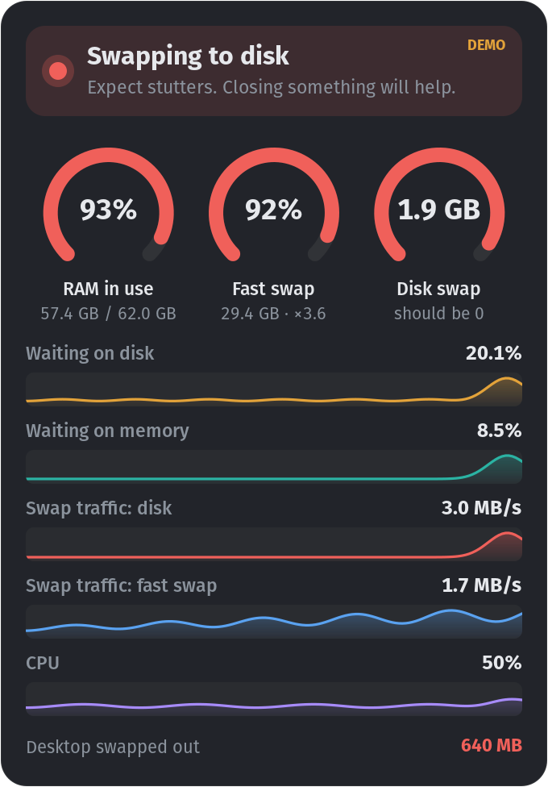

# Headroom

A small, always-on-top gauge of memory and swap health for the Linux desktop.



It answers one question: is this machine about to freeze? On a machine with
zram (compressed swap held in RAM) plus a swap partition on a slow disk, the
freezes come when swap spills out of zram onto the disk. System Monitor and
GKrellM add every swap device into one total, which hides exactly that.
Headroom keeps **fast swap** (zram) and **disk swap** apart and says in words
which one is in use.

It shows:

- RAM in use, fast swap (with its compression ratio) and disk swap
- pressure stall graphs: time spent waiting on disk and on memory
- swap traffic to disk and to zram, and CPU
- how much of the desktop shell (gnome-shell) has been swapped out

## Free up memory

RAM and fast swap creep up as the day goes on. **Free up memory…** (the button at
the bottom of the widget, or its right-click menu) shows what is holding them and
helps you give it back:

- **What is using memory**: every app, service and container with the RAM and
  fast swap it holds, counted per app (all of Chrome's processes together), from
  the counters systemd keeps for each app. Sort by total, RAM or fast swap, and
  open **Processes** to see and end the parts of an app, such as an IDE's helpers.
- **Suggestions**: what looks stale, ready ticked. An app whose windows you have
  not looked at for an hour, an app with no window that has been idle for half an
  hour, a container doing nothing, or anything whose memory the kernel has mostly
  pushed out to swap because nothing has touched it.
- **Nothing closes without asking.** You confirm a list that says what will happen
  to each. Apps are closed through their own windows, as if you clicked close, so
  they can save or ask first. Containers get `docker stop`; system services such as
  a database ask for your password. Anything that does not close is reported, with
  a **Force quit** for when it is stuck.

Headroom watches which app has focus and which are using CPU all the time it
runs, and remembers it in `~/.config/headroom/activity.json`, so the longer it
runs the better it knows what has gone unused. Focus tracking needs X11 and
libwnck (`gir1.2-wnck-3.0`); without them it judges by CPU alone. Your own
systemd services are listed but never suggested, and the desktop's own services
are listed but cannot be closed from here.

## Requirements

Python 3 with PyGObject (GTK 3), Pango and pycairo. These come with most GNOME
desktops (`python3-gi`, `python3-gi-cairo`, `gir1.2-gtk-3.0`). It reads `/proc`
and `/sys` only: no root, no daemon. Closing things uses `systemctl`, `docker` and,
for system services, `pkexec`. It was written for Pop!_OS but should work
on any GTK desktop.

## Usage

```bash
./headroom.py                     # run the widget
./headroom.py --demo              # run it on made-up data, to see every state
./headroom.py --screenshot F.png  # render the widget to a PNG and exit
./install.sh                      # add it to the applications menu
./uninstall.sh                    # remove the menu entry and login item
```

Right-click the widget for its size, "Start at login" and other options.
Settings are kept in `~/.config/headroom/`.

## Why GTK and not Electron

A memory monitor must not add to memory pressure. GTK 3 and Cairo keep it to a
few tens of MB, where an Electron app would cost several hundred.

## Licence

MIT. See [LICENSE](LICENSE).
